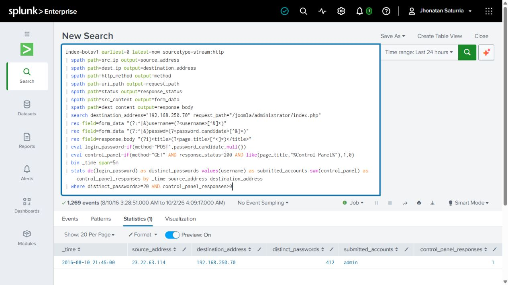

# Splunk BOTS v1: Joomla incident investigation

This personal lab uses Splunk to investigate suspicious activity against a Joomla website in the BOTS v1 training dataset. I found web scanning, repeated administrator login attempts, and later activity in the administrator area.

I ran the key searches, inspected individual requests and responses, compared timestamps, and exported the result tables directly from Splunk.

## Findings

- HTTP records and Suricata alerts show web scanning from `40.80.148.42` against `imreallynotbatman.com` at `192.168.250.70`.
- `23.22.63.114` submitted 412 different password values for `admin` in about 90 seconds. The server returned an administrator Control Panel page during the burst.
- `40.80.148.42` submitted the credential found at chronological candidate #319 in the guessing burst, received a Control Panel response, and submitted obfuscated PHP as `agent.php`. Later responses to `23.22.63.114` contained the code's output marker, supporting web shell interaction.

## Detection

I tested a search for at least 20 different submitted password values per source, account, and destination in a fixed five-minute bucket. It detected the 412-value burst; 500 missed it. A second search correlated the burst with a Control Panel response from the same source. These are detection prototypes: the attack-only dataset cannot establish a production threshold. The tuning notes describe the baseline and operational checks needed before deployment.

## Project files

- [Investigation report](reports/incident-report.md)
- [Investigation searches](searches/investigation.md)
- [Detection search and tuning notes](searches/password-guessing-detection.md)
- [Evidence descriptions](evidence/README.md) and [native CSV exports](evidence/native-exports/)

## What I learned

I found that 45 more login POSTs were recorded over 10.61 seconds after the administrator Control Panel appeared. Parallel or already queued requests could explain this; it does not show that a tool ignored success. The closest preceding POST was #367, while the uploader's value matched #319. This taught me to separate credential matches, recorded event order, and session evidence when explaining an access path.

## Reproduce the lab

1. Follow the setup instructions in [Splunk's BOTS v1 repository](https://github.com/splunk/botsv1) for the pre-indexed attack-only dataset. This lab used Windows and Splunk Enterprise 10.6.0.5.
2. Run the investigation searches individually against `index=botsv1`.
3. Run the detection search and compare its result with the native export.

The incident occurred on August 10, 2016. Report and timed CSV exports use UTC. See the [report](reports/incident-report.md#limitations) for investigation scope and limitations.

The dataset is credited to Splunk and the BOTS authors and is not redistributed here.

